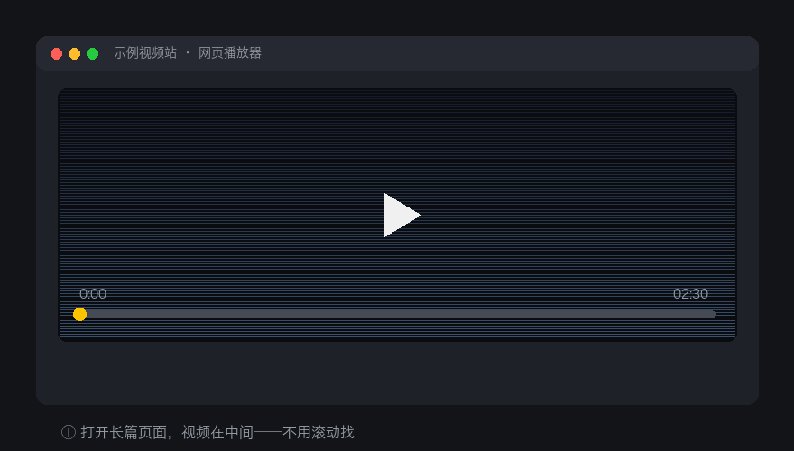

# 视频增强 · Video Enhancer

一个通用的网页视频增强油猴脚本：**不用先点进度条，直接按键盘就能快进快退**；长页面自动定位到视频；支持自动播放、全屏、画中画。

适用于所有带 HTML5 `<video>` 播放器的网站（含 iframe 内播放器）。

## 演示视频

<video src="https://github.com/user-attachments/assets/c631634b-5fe4-41cd-b03d-f4d0aa6a5efa" controls muted playsinline width="760"></video>

▶️ 播放器没显示？[点这里直接观看](https://github.com/user-attachments/assets/c631634b-5fe4-41cd-b03d-f4d0aa6a5efa)

演示内容：在长网页里自动定位到视频 → `→` 快进 → `↑` 调音量 → `空格` 暂停 → `回车` 全屏 → `ESC` 退出并回到视频原位置。

<details><summary>动图版（无声音，任何平台都能显示）</summary>



</details>

## 功能

| 按键 | 功能 |
|---|---|
| `←` / `→` | 快退 / 快进 10 秒（可配置） |
| `↑` / `↓` | 音量 +10% / −10% |
| `空格` | 播放 / 暂停 |
| `回车` 或 `F` | 全屏 ⇄ 退出全屏 |
| `ESC` | 退出全屏（**并自动回到视频所在位置**，不会跳回页面顶部） |
| `P` | 画中画（浮窗播放） |
| `M` | 静音 / 取消静音 |
| `V` | 滚动定位到视频 |
| `Shift+Alt+A` | 切换本站自动播放开关 |

### 自动化能力

- **自动播放**：检测到页面上出现视频（含动态插入、iframe 内）即自动播放
- **绕过浏览器自动播放限制**：先尝试有声播放，被 Chromium 拦截则自动静音播放并提示「按 M 开声音」
- **自动定位**：视频不在可视区时自动滚动到视频位置（长页面不用手动找）
- **退出全屏保持位置**：全屏退出后回到视频所在处，而不是页面顶部

## 安装

1. 先安装 [Tampermonkey](https://www.tampermonkey.net/)（或 Violentmonkey / ScriptCat）
2. **从 Greasyfork 安装（推荐）**：https://greasyfork.org/zh-CN/scripts/603438
3. 或从 GitHub 安装：https://raw.githubusercontent.com/liming-github/dsh-video-enhancer/main/video-enhancer.user.js

## 配置

打开脚本开头修改：

```js
var STEP = 10;                    // 快进/快退秒数，改 3 就是每次 3 秒
var VOL_STEP = 0.1;               // 音量步长，0.05 = 每次 5%
var SHOW_TOAST = true;            // 是否显示顶部提示
var AUTOPLAY = true;              // 是否自动播放
var AUTOPLAY_MUTED = true;        // 被拦截时先静音播放
var MIN_SIZE = 150;               // 小于该尺寸视为广告位，不自动播放
var AUTO_SCROLL = true;           // 自动滚动到视频位置
var SCROLL_IF_OFFSCREEN = true;   // 仅在视频不在可视区时才滚
var RESTORE_SCROLL_ON_EXIT = true;// 退出全屏后回到视频位置
```


## 更新与维护

本脚本有两处发布源，始终保持内容一致：

| 来源 | 地址 | 更新方式 |
|---|---|---|
| Greasyfork（推荐给用户） | https://greasyfork.org/zh-CN/scripts/603438 | 上传新版本 |
| GitHub（源码与历史） | https://github.com/liming-github/dsh-video-enhancer | `git push` |

**发新版流程（3 步）**

```bash
# 1. 在本地仓库执行（自动改版本号、提交、推送、并把文件送到 MacBook 桌面）
./scripts/release.sh 1.7.2 "修复某某问题"

# 2. 打开 Greasyfork 新版本页，选择 MacBook 桌面上的 video-enhancer.user.js
#    https://greasyfork.org/zh-CN/scripts/603438/versions/new

# 3. 点「发布」即可，用户端油猴会自动提示更新
```

脚本头部 `@version` 是更新判断依据，**每次发版必须递增**，否则用户端不会更新。

## 兼容性说明

- 只处理 `duration` 已知且大于 1 秒的 `<video>`；纯图片/装饰广告不会被接管
- 输入框、文本域、可编辑区域、按钮、链接上的按键**不拦截**
- `Ctrl / Alt / Cmd` 组合键一律放行
- 捕获阶段拦截并 `stopImmediatePropagation`，不会与播放器重复触发
- **全屏与画中画必须由用户按键触发**（浏览器安全策略），脚本无法自动执行
- 跨域 iframe 且站点启用 CSP 限制时，脚本可能无法注入该 frame

## 更新日志

见 [CHANGELOG.md](./CHANGELOG.md)

## 支持作者 ☕

这个脚本完全免费、无广告、不上传任何数据。如果它帮你省了时间，可以请我喝杯咖啡：

**微信赞赏码**（扫码即可，金额随意）


**爱发电**：https://ifdian.net/u/195fa88ad6b711f1ac9e5254001e7c00

你的支持会让这个脚本持续更新下去（新功能、兼容更多站点）。
